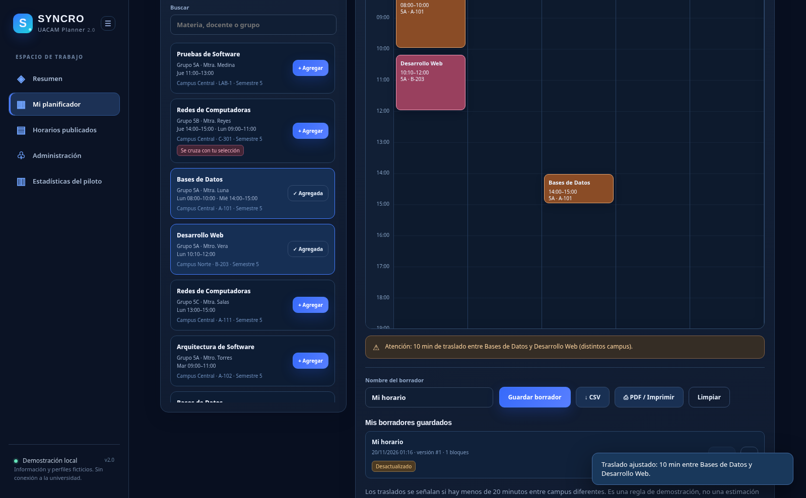
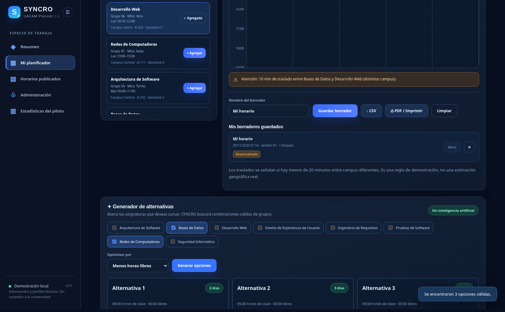
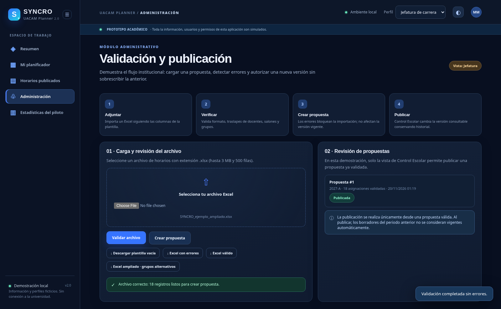
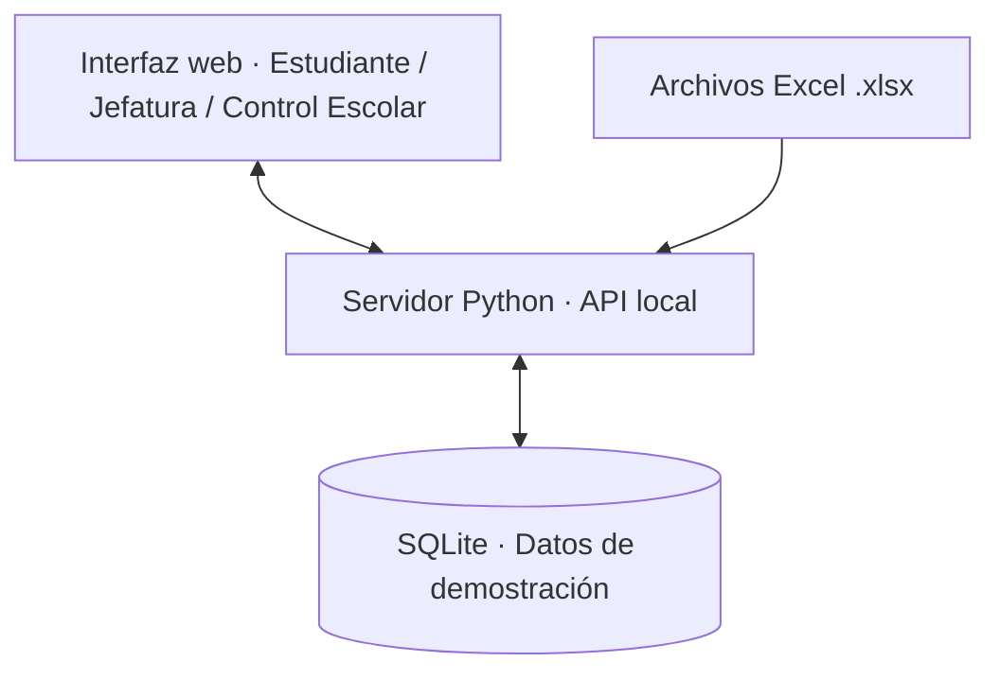

<div align="center">

# 🎓 SYNCRO 2.0

### UACAM Planner · Gestión y planificación académica

**Una sola versión de tus horarios. Más claridad para todos.**


**Desarrollado por Moran Makers** · Universidad Autónoma de Campeche (UACAM)

</div>

> [!IMPORTANT]
> **Prototipo de demostración, no servicio oficial de la UACAM.** Los alumnos, perfiles, horarios y cupos mostrados son ficticios. No realiza inscripciones, no se conecta a Control Escolar y **no debe utilizarse con información académica confidencial o datos personales reales**. Los roles se simulan en la interfaz; la API aún no implementa autorización institucional.

## 📖 Acerca de SYNCRO

**SYNCRO** es un prototipo de plataforma web que ayuda a **centralizar la consulta de horarios** y permite que los estudiantes **planeen su semestre antes de inscribirse**. Al mismo tiempo, representa un flujo administrativo para **importar, validar, aprobar y publicar** propuestas de horarios desde archivos Excel.

El proyecto responde a problemas como la circulación de versiones desactualizadas, los cruces de materias, las asignaciones simultáneas de aulas o docentes y la dificultad para organizar la carga académica.

El objetivo es demostrar un flujo de información coherente:

```text
Jefatura de carrera
       ↓
Importación y validación de Excel
       ↓
Revisión y publicación por Control Escolar
       ↓
Horarios publicados y consultables
       ↓
Planificación estudiantil y borradores
```

## 📑 Contenido

- [Funcionalidades](#-funcionalidades)
- [Capturas](#-capturas)
- [Tecnologías y arquitectura](#-tecnologías-y-arquitectura)
- [Instalación y ejecución](#-instalación-y-ejecución)
- [Guía rápida de demostración](#-guía-rápida-de-demostración)
- [Archivos Excel de ejemplo](#-archivos-excel-de-ejemplo)
- [Pruebas](#-pruebas)
- [Estructura del repositorio](#-estructura-del-repositorio)
- [Documentación](#-documentación)
- [Alcance y limitaciones](#-alcance-y-limitaciones)
- [Equipo y colaboración](#-equipo-y-colaboración)

## ✨ Funcionalidades

| Módulo | Qué permite hacer |
|---|---|
| 📅 **Planificador estudiantil** | Filtrar y seleccionar materias, visualizar sesiones en el calendario semanal, detectar cruces y recibir advertencias de traslado entre campus. |
| 💾 **Borradores de horarios** | Guardar, recuperar y eliminar distintos planes por perfil de alumno ficticio; exportar CSV e imprimir/guardar como PDF desde el navegador. |
| 🔄 **Generador de alternativas** | Buscar hasta tres combinaciones de grupos sin cruces, según preferencias como días de asistencia u horas libres. |
| 🔎 **Horarios publicados** | Consultar materias y grupos en tabla o calendario, filtrar resultados y revisar versiones anteriores. |
| 🗂️ **Administración** | Cargar archivos `.xlsx`, detectar errores y traslapes de aulas/docentes/grupos, generar propuestas y publicar versiones. |
| 📊 **Estadísticas del piloto** | Mostrar tendencias experimentales de selección de materias a partir de borradores de prueba. |
| 🎨 **Interfaz adaptable** | Tema claro/oscuro, menú lateral plegable y diseño para computadora o móvil. |

## 🖼️ Capturas

### Planificador académico



### Generador de alternativas



### Administración de horarios



## 🛠️ Tecnologías y arquitectura

| Capa | Tecnología | Propósito |
|---|---|---|
| Presentación | HTML, CSS y JavaScript | Pantallas, calendario, navegación y formularios. |
| Servidor | Python 3.10+ | API local, reglas de validación, simulación y publicación. |
| Persistencia | SQLite | Versiones, propuestas, bitácora y borradores locales. |
| Excel | `openpyxl` | Importación y validación de archivos `.xlsx`. |
| Pruebas | `unittest` | Verificación automatizada de reglas y flujos principales. |



El servidor se ejecuta localmente en `127.0.0.1`; **no es un despliegue público ni multiusuario en producción**.

## 🚀 Instalación y ejecución

### Requisitos

- **Python 3.10 o superior** instalado.
- Windows, Linux o macOS.
- Navegador actualizado (Chrome, Edge o Firefox).
- Conexión a internet para instalar dependencias si aún no están disponibles.

### Opción A · Windows (más fácil)

1. Descarga o clona este repositorio.
2. Abre la carpeta principal del proyecto.
3. Ejecuta **`INICIAR_SYNCRO.bat`**.
4. Abre **http://127.0.0.1:8765** si el navegador no se abrió automáticamente.
5. Mantén abierta la consola mientras uses el prototipo.

### Opción B · Visual Studio Code / terminal

Clona el repositorio:

```bash
git clone https://github.com/Rafa093Spartan/SYNCRO_MoranMakers.git
cd SYNCRO_MoranMakers
```

Instala las dependencias:

```bash
python -m pip install -r requirements.txt
```

Inicia el servidor:

```bash
python server.py
```

Abre **http://127.0.0.1:8765** en tu navegador. Para detener el programa, utiliza **Ctrl + C** en la terminal.

> **Notas:** En algunas instalaciones de Windows se usa `py -3` en lugar de `python`; en Linux/macOS suele usarse `python3`. No abras `web/index.html` directamente: la interfaz necesita la API de Python. Si el puerto está ocupado, cierra otra instancia de SYNCRO.

## 🎬 Guía rápida de demostración

1. Cambia el perfil superior a **Jefatura de carrera** y abre **Administración**.
2. Carga el archivo **`SYNCRO_ejemplo_con_errores.xlsx`** y usa **Validar archivo** para mostrar conflictos detectados.
3. Carga el **Excel ampliado**, valida su contenido y selecciona **Crear propuesta**.
4. Cambia al perfil **Control Escolar** y utiliza **Aprobar y publicar**.
5. Abre **Horarios publicados** para comprobar la nueva versión y los filtros.
6. Cambia a **Estudiante** y abre **Mi planificador**. Agrega materias, observa el calendario y prueba una selección con choque.
7. Guarda **Plan A**; prueba **Generar opciones**, aplica una alternativa y guarda **Plan B**.
8. Abre **Estadísticas del piloto** para observar la información generada por los borradores.

> Los perfiles de alumno `01`, `02` y `03` son de demostración. Guardar un plan **no implica inscribirse en materias**.

## 📄 Archivos Excel de ejemplo

La carpeta [`ejemplos/`](ejemplos/) incluye:

| Archivo | Uso |
|---|---|
| `SYNCRO_plantilla.xlsx` | Plantilla vacía con las columnas esperadas. |
| `SYNCRO_ejemplo_con_errores.xlsx` | Demostración de errores detectables. |
| `SYNCRO_ejemplo_valido.xlsx` | Carga válida de ejemplo. |
| `SYNCRO_ejemplo_ampliado.xlsx` | Grupos alternativos y clases distribuidas en varios días; recomendado para la exposición de 2.0. |

Los encabezados requeridos son:

```text
periodo, carrera, semestre, grupo, materia, docente,
salon, campus, dia, inicio, fin, capacidad
```

**Límite actual:** archivos `.xlsx` de hasta **3 MB** y **500 filas**.

## 🧪 Pruebas

Para ejecutar las pruebas desde la carpeta raíz:

```bash
python -m unittest discover -s tests -v
```

La versión 2.0 dispone de **14 pruebas automatizadas** documentadas, que incluyen validación de Excel, cruces de horarios, propuestas, publicación, sesiones múltiples, borradores y alternativas. También se verificó un recorrido de demostración mediante navegador automatizado.

Consulta los [resultados de las pruebas](docs/RESULTADOS_PRUEBAS_V2.md). Estos resultados no sustituyen una auditoría de seguridad, pruebas de carga o una validación institucional.

## 📂 Estructura del repositorio

```text
SYNCRO_MoranMakers/
├── data/                       # Base local generada al ejecutar (no subir datos privados)
├── docs/
│   ├── capturas/               # Imágenes del prototipo
│   ├── ANALISIS_Y_ALCANCE_V2.md
│   ├── GUIA_EXPOSICION_10MIN_V2.md
│   └── RESULTADOS_PRUEBAS_V2.md
├── ejemplos/                   # Excel ficticios y plantilla
├── presentacion/               # Presentación de exposición
├── tests/                      # Pruebas automatizadas
├── web/
│   ├── index.html
│   ├── style.css
│   └── app.js
├── INICIAR_SYNCRO.bat          # Inicio rápido en Windows
├── INICIAR_SYNCRO.sh           # Inicio para Linux/macOS
├── PROBAR_SYNCRO.bat           # Pruebas en Windows
├── server.py                   # API, reglas y base de datos
├── requirements.txt            # Dependencias de Python
├── LEEME.md                    # Manual de inicio ampliado
└── README.md                   # Presentación principal de GitHub
```

## 📚 Documentación

- 📘 [Guía técnica y de uso del prototipo](LEEME.md)
- 🧩 [Análisis, alcance y trazabilidad de requisitos](docs/ANALISIS_Y_ALCANCE_V2.md)
- 🎤 [Guion para exposición de 10 minutos](docs/GUIA_EXPOSICION_10MIN_V2.md)
- ✅ [Resultados de pruebas](docs/RESULTADOS_PRUEBAS_V2.md)
- 📽️ [Presentación para exposición](presentacion/SYNCRO_Presentacion_2_0_10min.pptx)

## ⚠️ Alcance y limitaciones

**Incluido en la demostración:** importación y validación local de Excel, publicación versionada, consulta de horarios, selección de materias, alertas, borradores y estadísticas experimentales.

**Pendiente antes de un uso institucional:**

- Autenticación real con matrículas y cuentas institucionales.
- Permisos y seguridad aplicados en el servidor.
- Conexión autorizada con sistemas y datos oficiales de la UACAM.
- Información real de inscripción, cupos y planes de estudio.
- Cifrado y tratamiento formal de datos personales.
- Pruebas de rendimiento, accesibilidad, seguridad y operación a escala.
- Aplicación móvil nativa (la versión actual es web adaptable).

Las alertas de traslado usan un umbral fijo de **20 minutos**, no cálculos reales de desplazamiento. Las estadísticas reflejan selecciones ficticias, no matrículas ni demanda oficial.

## 👥 Equipo y colaboración

**Moran Makers** · Proyecto académico enfocado en facilitar la planificación de horarios y explorar una gestión más clara de la información escolar.

Repositorio mantenido en GitHub: [Rafa093Spartan/SYNCRO_MoranMakers](https://github.com/Rafa093Spartan/SYNCRO_MoranMakers).

Para colaborar, se recomienda abrir una **Issue** para cada mejora y trabajar los cambios mediante ramas y **Pull Requests**.

> **Licencia:** este repositorio no incluye por ahora una licencia de uso explícita. Su visibilidad pública no concede automáticamente derechos de reutilización, modificación o distribución a terceros.

---

<div align="center">

**SYNCRO 2.0 · Moran Makers**

*Una sola versión de tus horarios. Más claridad para todos.*

</div>
